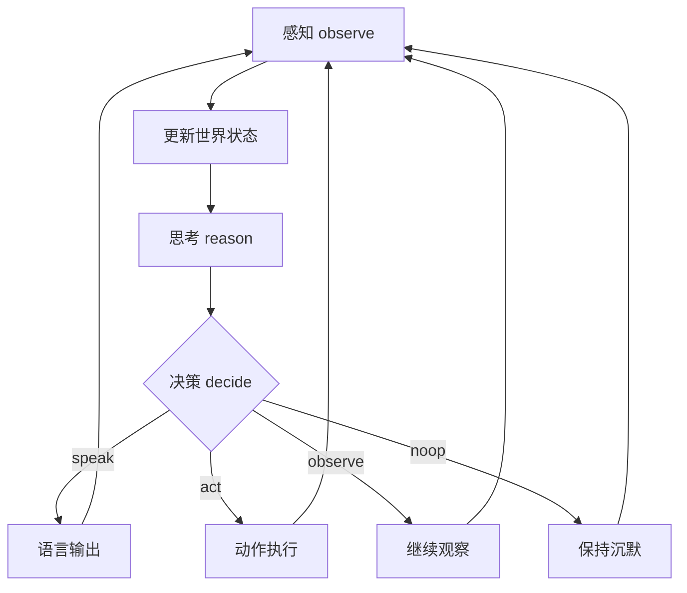

# 自主决策循环（ReAct + noop）

## 1. 为什么需要「可沉默」

经典 ReAct 循环是：

```
思考(Thought) → 行动(Action) → 观察(Observation) → 循环
```

它隐含假设：每一轮都要产出动作。但对一个追求「自主性」的 Agent 来说，**「想完什么都不做」同样重要**——环境不需要它响应时，它应该能保持沉默、维持内部状态、等待下一个值得回应的时刻。这不是失败，而是一个合法决策。

因此本项目的核心循环是：

```
观察 → 更新世界状态 → 思考（该不该回应？关注什么？）
→ 决策：说 / 做 / 沉默(noop) → （可选）对外副作用 → 观察新状态 → 循环
```

## 2. 动作空间

Agent 的动作空间显式包含四类动作：

| 动作 | 对外副作用 | 说明 |
|---|---|---|
| `speak(text)` | 有（输出语言） | 开口说话 / 输出文本 |
| `act(call)` | 有（调用工具/执行动作） | 操作环境、调 API、移动 |
| `observe()` | 无 | 继续感知、收集更多信息（可看作持续观察态） |
| `noop()` | **无** | 什么都不做，维持内部状态，等待下一轮 |

**关键**：`observe()` 与 `noop()` 都不产生对外副作用，区别在于 `noop()` 表示「我判断现在无需行动，保持静默」，且会同步维持/推进内部状态。

## 3. 循环伪代码

```python
while running:
    # 1. 感知：从所有启用的传感器采集观测
    observations = perceive()

    # 2. 更新世界状态与记忆
    world_state.update(observations)

    # 3. 思考：结合世界状态与自我模型，决定关注点/意向
    intent = reason(world_state, self_model)

    # 4. 决策：从动作空间选择
    action = decide(intent)     # speak / act / observe / noop

    # 5. 执行（可选）。若为 noop/observe，则不产生对外副作用
    if action == "speak":
        speak(action.payload)
    elif action == "act":
        act(action.payload)
    else:
        pass                    # observe 或 noop：保持沉默

    # 6. 记录本轮结果 / 等待下一个节拍
    wait(interval)
```

## 4. 决策核心：内在动机

让 Agent 自主判断「是否值得回应」，需要一个**内在动机/价值信号**驱动，而非单纯等待人类 prompt。示例信号：

- **环境变化度**（salience）：屏幕/环境发生显著变化时，更值得关注或回应。
- **信息增益**（curiosity）：某些状态能带来更多新信息时，倾向去观察。
- **任务相关性**：当前是否正处于某一目标上下文内。
- **舒适/自保倾向**：是否需要对潜在风险作出反应。

这些不是硬编码规则，而是注入给推理模型的「意图提示」，让模型自主权衡。

## 5. 与普通 Agent 的差异

| 维度 | 普通 ReAct / Tool-use Agent | 本项目（可沉默自主 Agent） |
|---|---|---|
| 触发 | 通常由人类指令/工具需求触发 | 由环境感知 + 内在动机触发 |
| 每轮是否必须输出 | 基本必须 | **可选择不输出**（noop） |
| 思考来源 | 任务上下文 | 持续的世界状态 + 自我模型 |
| 感知 | 按需取一次 | 持续感知流 |

## 6. 状态机视图 (Mermaid)



## 7. 下一步实现重点

1. 完成 `loop.py` 主循环骨架。
2. 先做一个纯文本版 demo（`examples/silent_agent_demo.py`），验证「想完可以不说话」。
3. 接读屏，把真实环境观测接入循环。
4. 引入内在动机信号（环境变化检测）。
