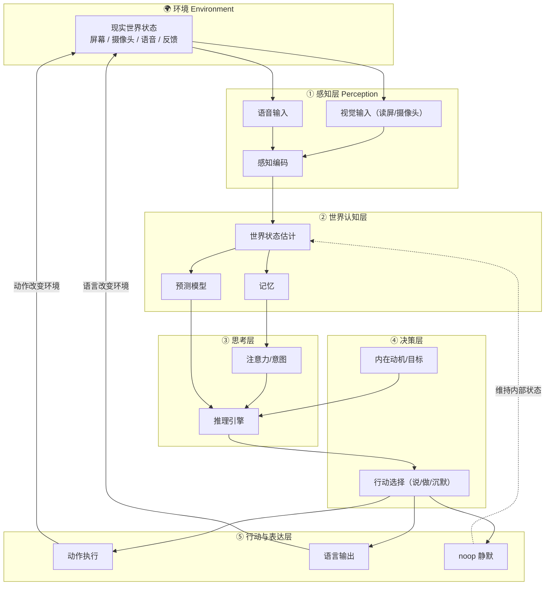

# 总体架构（AURA）

> **AURA** = **A**utonomous **U**nderstanding & **R**eactive **A**wareness

## 1. 目标

本项目构建一个具备**自主性倾向**的环境感知 Agent。所谓自主性，这里特指：

> Agent 能主动从环境中持续获取信息（而非等人喂），自主决定「我该关注什么」，并自主决定「是否对外输出（说话/动作）」——**包括选择什么都不做**。

## 2. 分层架构

```
┌────────────────────────────────────────────────────────────┐
│  🌍 环境 Environment                                        │
│   （屏幕画面 / 摄像头 / 语音 / 动作反馈）                    │
└──────────────────────────┬─────────────────────────────────┘
                           │ 持续感知流
┌──────────────────────────▼─────────────────────────────────┐
│  ① 感知层 Perception                                       │
│   sensor 适配 → 感知编码 → 特征/观测                        │
└──────────────────────────┬─────────────────────────────────┘
                           │
┌──────────────────────────▼─────────────────────────────────┐
│  ② 世界认知层 World Model & Memory                         │
│   世界状态估计 / 记忆 / 预测模型                            │
└──────────────────────────┬─────────────────────────────────┘
                           │
┌──────────────────────────▼─────────────────────────────────┐
│  ③ 思考层 Reasoning                                        │
│   注意力/意图（我该关注什么？） + 推理引擎                 │
└──────────────────────────┬─────────────────────────────────┘
                           │
┌──────────────────────────▼─────────────────────────────────┐
│  ④ 决策层 Decision                                         │
│   内在动机 + 行动选择（说/做/保持沉默）                    │
└───────────────────────┬──────────────┬─────────────────────┘
                        │              │
        ┌───────────────▼───┐   ┌──────▼──────────────────┐
        │ ⑤ 行动层（可选） │   │  noop 静默分支           │
        │  动作/语言输出    │   │ （不产生对外副作用）      │
        └───────────────┬───┘   └─────────────────────────┘
                        │ 改变环境
                        └──────────▶ 回到 ①（闭环）
```

## 3. 模块职责

### core 包（核心循环）
| 模块 | 职责 |
|---|---|
| `perceive.py` | 从传感器采集原始输入，编码为观测 |
| `world_state.py` | 维护持续更新的世界状态与记忆 |
| `reason.py` | 依据世界状态 + 自我模型做推理/权衡 |
| `decide.py` | 结合意图，从动作空间选择 说/做/沉默 |
| `act.py` | 执行外部副作用（说话/动作/工具调用） |
| `loop.py` | 组织「感知→思考→决策→行动/沉默」主循环 |

### sensors 包（传感器抽象）
统一接口 `Sensor`，便于接入多种感知源：

- `screen`：读屏（Windows OCR / 屏幕捕获）
- `camera`：摄像头（后续扩展）
- `audio`：语音输入（后续扩展）

### models 包（模型抽象）
- `VisionModel` / `LLM` 抽象，屏蔽本地推理细节（Ollama / llama.cpp / vLLM / transformers）。

## 4. 关键设计决策

1. **动作空间显式包含 `noop`**：这是本项目与普通 ReAct/Agent 的核心差异，让「保持沉默/不行动」成为合法决策。
2. **世界状态为独立实体**：不把感知当一次性输入，而是累积成状态，跨时间维持上下文。
3. **传感器用统一接口**：未来接摄像头、语音时无需改核心循环。
4. **模型可替换**：默认支持本地模型（隐私、离线、可控），也保留云端/OpenAI 兼容接口。

## 5. 模块图 (Mermaid)



## 6. 未来扩展点

- 多视频源融合（多路摄像头）
- 语音输入 + 语音输出（TTS）
- 本地视觉模型（读屏 OCR 升级为 VLM）
- 世界模型 / 预测模块
- 时间上的持续记忆
